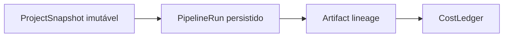
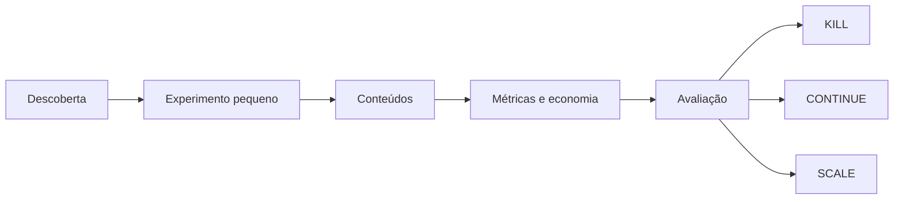

# Pipeline modular de conteúdo

## Objetivo

Definir a sequência, os artefatos e as fronteiras do MKTauto Portfolio-First sem
acoplar domínio ou aplicação a um fornecedor. Cada etapa recebe um contrato
validado, produz uma nova versão rastreável e não executa efeitos pertencentes à
etapa seguinte.

```text
ProjectSnapshot
       ↓
Topic Discovery → Reference Analysis
       ↓
Idea Generation → Idea Scoring → Human Idea Selection
       ↓
Script Generation
       ↓
Voice Generation + Media Provision
       ↓
Video Composition → Subtitle Generation → Metadata Generation
       ↓
Quality Validation → Preview → Human Approval
       ↓
Scheduling → Publishing → Analytics → Revenue Analytics
       ↓
Optimization Recommendation → Portfolio Allocation Recommendation
```

No MVP 1 o fluxo termina em `Preview`. Pesquisa existente pode sugerir temas,
mas o operador também pode informar um tema diretamente. Revenue Analytics,
experimentos, otimização e alocação são capacidades posteriores.

## Fundação de execução e economia

Antes de ampliar a automação, cada conteúdo deve preservar esta cadeia:



`PipelineRun` continua sendo a unidade técnica de execução. O snapshot fixa a
configuração; a linhagem explica cada saída; eventos de custo registram consumo
atribuível. As entregas serão incrementais: persistir a run não autoriza criar de
uma vez todos os artefatos, providers ou métricas financeiras.

## Envelope comum dos artefatos

Todo artefato persistido deve possuir, quando aplicável:

```text
artifact_id
content_id
project_id
project_version
pipeline_run_id
artifact_type
schema_version
revision
created_at
created_by
provider
provider_model
prompt_version
generation_configuration
input_hash
output_hash
provider_cost
provider_latency_ms
input_artifact_ids
content_hash
rights
storage_reference
```

Os campos de geração aplicam-se apenas a artefatos gerados por IA e devem ser
sanitizados. Arquivos de mídia ficam fora do Git. `storage_reference` nunca expõe
token ou URL privada permanente. Um artefato substituído não é alterado: cria-se
nova revisão. Segredos e prompts completos potencialmente privados não compõem a
linhagem.

## 1. Project Configuration

Entrada: dados fornecidos pelo operador. Saída: `ProjectSnapshot` imutável.

O snapshot contém nicho, subnichos, público, idioma, referências, formato,
limites de duração, voz, visual, frequência, destinos e horários. Defaults são
aplicados de forma determinística e erros apontam o campo inválido.

Nenhuma execução em andamento muda quando o projeto é editado; a próxima run usa
uma nova versão do snapshot.

## 2. Research

Entradas: `ProjectSnapshot`, janela e capacidades oficiais disponíveis. Saídas:
`TopicCandidate[]` e `ReferenceInsight[]`.

- reutiliza radar, adapters, histórico, clustering e ranking atuais;
- consulta apenas APIs oficiais;
- registra cobertura, lacunas e bloqueios por fonte;
- não baixa ou republica mídia encontrada;
- distingue métrica observada, inferência e dado indisponível;
- analisa padrões agregados, não copia material protegido.

`TrendSource` e `ReferenceAnalyzer` são portas distintas. Uma rede pode suportar
uma capacidade e não a outra.

## 3. Content Intelligence

Entradas: snapshot, tema, insights e políticas editoriais. Saídas:
`IdeaCandidate[]` e `IdeaScore[]`.

O gerador propõe ideias originais. O scorer determinístico considera adequação ao
nicho, novidade relativa, evidências, viabilidade, risco, custo e diversidade.
IA não inventa métricas ou decide direitos. No MVP, o operador seleciona uma ideia
antes da geração de roteiro.

## 4. Script and Metadata

Entrada: ideia aprovada. Saídas: `Script` e, após o vídeo existir,
`ContentMetadata` por plataforma.

O roteiro contém hook, blocos narrativos, texto da narração, indicações visuais,
CTA e duração estimada. Afirmações sensíveis indicam origem ou revisão necessária.

Metadados incluem título, descrição, CTA e hashtags, respeitando limites e
capacidades da plataforma. Metadados nunca são tratados como publicados.

## 5. Voice Generation

Entrada: roteiro e perfil de voz. Saída: `VoiceTrack`.

`VoiceProvider` recebe texto, idioma, estilo e limites. A saída registra duração,
formato, hash, provider e direitos de uso. Clonagem ou imitação de voz não entra no
MVP sem consentimento e revisão próprios.

## 6. Media Provision

Entrada: necessidades visuais do roteiro. Saída: `MediaAsset[]`.

Um adapter pode gerar imagem/vídeo ou localizar mídia autorizada. Cada ativo deve
declarar origem, tipo de direito, restrições e hash. Ausência de direito conhecido
bloqueia composição. Referências sociais não são banco de mídia.

## 7. Video Composition and Subtitles

Entradas: roteiro, voz, mídia e configuração visual. Saídas: `CompositionPlan`,
`VideoRender` e `SubtitleTrack`.

O composer é determinístico: monta canvas vertical, timeline, transições, áudio e
legendas a partir do plano validado. O primeiro formato é `9:16`; outros entram
somente quando um tópico exigir. Alterar plano, mídia, áudio ou legenda gera novo
render e invalida validações e aprovações anteriores.

## 8. Quality Control

Entrada: versão completa. Saída: `ValidationReport`.

Checks obrigatórios:

- vídeo, áudio, legendas e metadados existem;
- duração, resolução, proporção e formatos são válidos;
- render pode ser lido integralmente;
- arquivos e textos não estão vazios;
- limites conhecidos da plataforma são respeitados;
- mídia possui origem e direito declarados;
- hashes e referências são consistentes;
- não há duplicação conhecida da versão;
- riscos editoriais e conteúdo potencialmente inadequado estão sinalizados.

Um relatório separa `ERROR`, `WARNING` e `INFO`. Qualquer `ERROR` impede
aprovação. Correção cria nova revisão e exige nova validação.

## 9. Preview and Approval

O preview apresenta a versão exata e seu relatório. `Approval` registra
`content_version_id`, hash do render, ator, instante e decisão.

Somente aprovação humana é válida no MVP. Qualquer mutação posterior invalida a
aprovação. Aprovação automática é possibilidade pós-MVP condicionada a novo gate,
política explícita e trilha auditável; não faz parte da arquitetura executável
atual.

## 10. Scheduler and Publishing

Entrada: versão aprovada e agenda. Saídas: `PublishingJob` e `Publication`.

```text
PublishingJob
├── content_version_id
├── platform
├── scheduled_at
├── state
├── attempts
├── idempotency_key
├── last_error_code
├── published_at
└── external_post_id
```

O scheduler persiste o job antes do efeito externo. Timeout leva a reconciliação
por chave/estado externo antes de retry. Nunca cria uma segunda publicação apenas
porque a resposta foi perdida.

`SocialPublisher` expõe capacidades declaradas, como vídeo, imagem, texto, status
e exclusão. Instagram, Facebook, Threads e TikTok são adapters separados. O
publisher recebe a versão exata aprovada e não gera ou altera conteúdo.

## 11. Analytics

Entrada: publicação reconciliada. Saída: `MetricSnapshot`.

Views, likes, comentários, compartilhamentos, salvamentos, alcance, watch time,
retenção e seguidores ganhos são opcionais. O snapshot registra quais métricas a
plataforma forneceu, janela, instante e cursor. Ausência não vira zero.

## 12. Revenue Analytics e Content Economics

Entradas: publicações, conteúdos, runs, custos e eventos de monetização. Saídas:
`RevenueEvent`, `RevenueSnapshot` e visões econômicas históricas.

Custos previstos incluem `production_cost`, `ai_cost`, `media_cost`,
`voice_cost` e `publishing_cost`. Receitas previstas incluem
`platform_revenue`, `affiliate_revenue`, `product_revenue`, `lead_revenue`,
`sponsorship_revenue` e `other_revenue`. As estratégias suportadas são anúncios
de plataforma, afiliados, produto próprio, geração de leads, patrocínio, serviço,
assinatura e outras fontes explícitas.

`RevenueSource` identifica a origem e `RevenueEvent` registra valor, moeda,
instante, janela, referência externa sanitizada e regra de atribuição. Eventos
financeiros e snapshots são append-only; correções geram novos eventos, nunca
reescrevem o histórico. Agregações entre moedas exigem taxa, fonte e instante de
conversão registrados.

As visões podem derivar `gross_revenue`, `net_revenue`, `profit`, `margin`, `roi`,
receita por mil visualizações, conversão por CTA e retorno por plataforma ou
estratégia. Custos, receitas, lucro e ROI devem funcionar por conteúdo, canal,
projeto e nicho; portfólio agrega somente valores comparáveis. Nenhum limiar
financeiro para matar ou escalar experimento é definido agora.

## 13. Experimentos de portfólio



Um experimento registra hipótese, escopo, configuração, janela, capacidade
alocada, evidências e decisão. `ExperimentPolicy`, `KillPolicy` e `ScalePolicy`
são configuráveis, versionadas e explicáveis. A recomendação não encerra canal,
não publica e não aumenta orçamento sem validação humana ou política explícita
aprovada em tópico próprio.

## 14. Optimization Engine

Entradas: histórico de conteúdo, características, métricas e economia. Saída:
`OptimizationRecommendation`.

O primeiro mecanismo usa estatísticas, médias, comparações e regras explícitas.
Ele poderá correlacionar nicho, subnicho, tema, hook, roteiro, estrutura, duração,
voz, visual, CTA, horário, plataforma, retenção, engajamento, conversão, custo,
receita, lucro e ROI. Toda saída liga evidências e versão da política à sugestão.

```text
Evidence → Optimization Engine → Recommendation
         → Human/Policy validation → Apply / Reject
```

Recomendações podem aumentar ou reduzir prioridade, mas não alteram configuração,
regras financeiras, conteúdo, canal ou publicação sem ação registrada do operador.

## 15. Portfolio Allocation

Entrada: capacidade/orçamento disponível, ROI, margem, histórico econômico,
crescimento, estabilidade, volume de dados, risco e custo. Saída:
`AllocationRecommendation` explicável por nicho, projeto, canal ou experimento.

Inicialmente a alocação apenas recomenda percentuais e explicita incerteza. Ela
não reserva orçamento, agenda produção, escala canal nem executa transferência.
Automação exige política e gate próprios.

## 16. Estratégia de providers de IA

Domínio e aplicação dependem de capacidades (`IdeaGenerator`, `ScriptGenerator`,
`ContentAnalyzer`, `OptimizationAdvisor`, `EmbeddingProvider`, `LLMProvider`),
nunca de SDKs. Para a geração do pipeline, OpenAI/GPT será o primeiro adapter:

```text
Application → AI Port → OpenAI Adapter → GPT
```

O Ollama já usado em Research permanece uma implementação isolada e não muda
essa fronteira. Local models, self-hosted e modelos especializados são opções
futuras. Não se implementam agora novos adapters, GPU, fine-tuning ou modelos
próprios.

## 17. Horizontes

| Horizonte | Pipeline |
|---|---|
| Atual | `ProjectSnapshot`, Research e artefatos de shortlist por projeto. |
| Próximo | `PipelineRun` persistido, depois linhagem e eventos de custo. |
| Futuro | Produção, publicação, métricas, receitas, experimentos, otimização e alocação. |

## Estados e transições

```text
DRAFT
  → IDEA_APPROVED
  → SCRIPT_READY
  → MEDIA_READY
  → VIDEO_READY
  → VALIDATED
  → APPROVED
  → SCHEDULED
  → PUBLISHED
  → ANALYZED
```

`FAILED`, `REJECTED` e `CANCELLED` exigem motivo. Recuperação de `FAILED` retoma
a etapa falha ou cria nova run; não reescreve o histórico.

Invariantes:

1. uma transição precisa constar da tabela permitida;
2. ator e instante são obrigatórios;
3. `APPROVED` referencia o hash validado;
4. apenas `APPROVED` pode avançar para `SCHEDULED`;
5. apenas um publisher executa um job por chave idempotente;
6. métricas só referenciam publicação reconciliada;
7. otimização registra evidências e versão da regra.

## Falhas e observabilidade

Cada etapa registra início, término, duração, estado, código de erro sanitizado,
tentativas, provider e consumo conhecido. Conteúdo privado, prompts completos com
dados do usuário, mídia e credenciais não entram em logs.

Falha de provider não deve apagar artefatos válidos. Se houver fallback, a troca
de provider fica registrada e gera um novo artefato. Cobertura parcial permanece
explícita na saída.

## Reuso do pipeline anterior

O antigo M1 vira `Research`. Seus contratos, catálogo, ranking e histórico
continuam válidos. Conceitos planejados de transcrição, linhagem, renderização e
QA podem ser reaproveitados em tópicos futuros, sem obrigar o MVP 1 a depender de
uma mídia-fonte. Composição de cortes e react permanece backlog pós-MVP.
